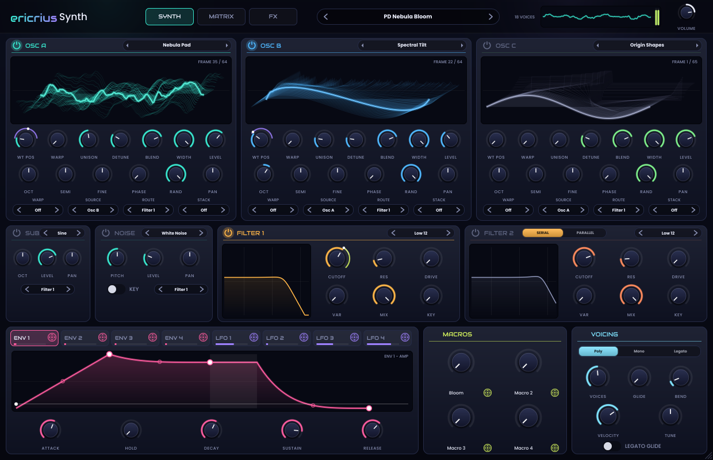

# ericriusSynth

A wavetable synthesizer for Ableton Live: three morphing wavetable oscillators, a sub and a noise
source, two multimode filters, drag-and-drop modulation from four envelopes, four drawable LFOs and four
macros, and a ten-effect rack. Everything here was written from scratch for the Adventure Pack: the DSP,
the 36 wavetables (generated mathematically), the noise sources, the presets and the interface.



## The signal path

```
 Osc A ┐                       ┌─ Filter 1 ─┐  serial: F1 -> F2
 Osc B ├─ route per source ────┤            ├─ (or parallel) ── Amp (Env 1) ── FX rack ── Volume
 Osc C │  (F1 / F2 / both /    └─ Filter 2 ─┘
 Sub   │   direct)
 Noise ┘
```

## Oscillators

Each oscillator plays a **wavetable**: up to 256 single-cycle frames that you sweep through with **WT Pos**.
Click the table name for the categorised library (Basic, Analog, Digital, Vocal, Spectral, FM, Bass, Keys &
Pads, Weird), or use the arrows to step through it. Click the 3D display to switch to a flat 2D view.

**Warp modes** bend each cycle before it's played (the display shows the result):

| Mode | What it does |
| --- | --- |
| Sync, Window Sync | hard-sync style: plays the frame faster inside each cycle (Window fades the edges) |
| Bend +, Bend -, Bend +/- | squeezes the cycle towards one end or the middle |
| PWM | squeezes the cycle into the first part, holding the rest |
| Asym +, Asym - | moves the cycle's midpoint |
| Flip | inverts the end of the cycle |
| Mirror | blends in a mirrored copy |
| Quantize | steps the phase for lo-fi digital edges |
| FM, AM, RM | frequency, amplitude or ring modulation from another source (pick it with **Source**: Osc A/B/C, Sub or Noise; picking the oscillator itself gives feedback FM) |

**Unison** stacks up to 16 voices: **Detune** spreads them, **Blend** balances the centre and side voices,
**Width** spreads them in stereo, and **Stack** can put alternate voices up an octave, down an octave, on a
fifth or on a chord. **Phase** sets the start phase and **Rand** randomises it per voice and note.

**Route** sends each source to Filter 1, Filter 2, both, or straight to the amp.

### Your own wavetables

Drop a WAV, AIFF or FLAC onto an oscillator's display, or use **Load wavetable** in the table menu.

- Files with a `clm ` chunk (the de-facto marker most wavetable synths write) use its frame size.
- Otherwise files whose length is a multiple of 2048 samples are read as 2048-sample frames.
- A short file (up to 4096 samples) becomes a single cycle.
- Anything longer is treated as a sample: ericriusSynth slices up to 64 single cycles out of it
  (pitch-detected where possible), so you can turn any sound into a wavetable.

Custom tables are saved inside your Live set and presets. **Export this wavetable** writes a standard
2048-sample-frame WAV that other wavetable synths can open.

## Filters

18 types: Low 12/24, Ladder, Diode, High 12/24, Band 12/24, Notch, Peak, Comb +/-, Flanger, Phaser,
Formant, Ring Mod, Downsample and Wasp. **Drive** saturates before the filter, **Mix** blends with the dry
signal and **Key** makes the cutoff follow the keyboard. **Var** does something different per type: extra
weight on the classic types, damping on the combs, notch spread on the phaser, the vowel on Formant, the
waveform on Ring Mod, bit depth on Downsample and the LP->BP->HP morph on Wasp.

## Modulation

Every round knob with a coloured value arc can be modulated.

- **Drag** the little cross-arrows handle from an ENV or LFO tab, a macro, or the source strip on the
  MATRIX page, and drop it on a knob.
- The knob grows a **ring** in the source's colour showing the depth, and a white **dot** that moves with
  the live, modulated value.
- **Alt-drag** (or Ctrl-drag) a knob to change the depth of its most recent routing.
- **Right-click** a knob to invert a routing, make it bipolar, zero it or remove it.
- The **MATRIX** page lists every routing (up to 32). There you can also pick a **Via** source that scales a
  routing's depth (for example LFO 1 -> Cutoff, via Mod Wheel).

Sources: Env 1-4, LFO 1-4, Macro 1-4, Velocity, Note, Mod Wheel, Aftertouch (channel or poly), Pitch Bend,
Random (per note), Alternate (flips every note) and Release Velocity. LFOs and envelopes are unipolar
(0..1), so modulation pushes the knob one way; tick **Bip** to swing both ways around the knob's position.

**Env 1 is always the amp envelope.** Drag the corners of the envelope graph, or the small rings in the
middle of each segment to bend it.

**LFOs** are drawn: click to add a point, drag to move it, double-click to delete it, drag a segment's ring
to curve it and right-click for preset shapes (sine, triangle, saws, square, pulse, steps, stairs, bounce,
random...). Each LFO can follow the song tempo (**Sync**), and has three modes:

- **Trig** restarts on every note;
- **Free** is one shared LFO. When synced and Live is playing it locks to the song position, so a 1-bar
  LFO always lines up with the bar;
- **Env** plays the shape once per note, like an extra envelope.

**Rise** fades the LFO in, **Delay** holds it off at the start of each note, **Smooth** rounds off sharp
corners and **Phase** offsets the start.

**Macros** are big knobs you can drag onto anything. Double-click a macro's name to rename it. They're
also the first four automation parameters, so they're the first things you'll see on Push.

## Effects

The FX page has Hyper (unison chorus + dimension), Distortion (11 modes), Flanger, Phaser, Chorus,
Delay (normal, ping-pong, tap; free or synced), Compressor (single band or three-band up/down
compression), Reverb (plate, hall, room), EQ and Filter. Drag the effects in the list to reorder them;
click the dot to switch one on. Effect knobs can be modulated too (they follow the most recent note's
envelopes and LFOs).

## Voicing

Poly (up to 32 voices), Mono or Legato, Glide (with an option to glide only between overlapping notes),
pitch-bend range, velocity sensitivity and master tune.

## Tips for Live

- **Push**: the first bank is Macro 1-4, Filter 1 Cutoff and Resonance, and Osc A and B position.
- **MPE-ish expression**: route Aftertouch (poly aftertouch works per note) to anything, e.g. Filter
  Cutoff or WT Pos.
- **Automation**: every knob is automatable in Live. For big moves, automate a macro and modulate several
  knobs from it.
- **CPU**: unison is the expensive part. A 16-voice unison pad on all three oscillators with long releases
  is heavy; a few voices per oscillator usually sounds just as wide.
